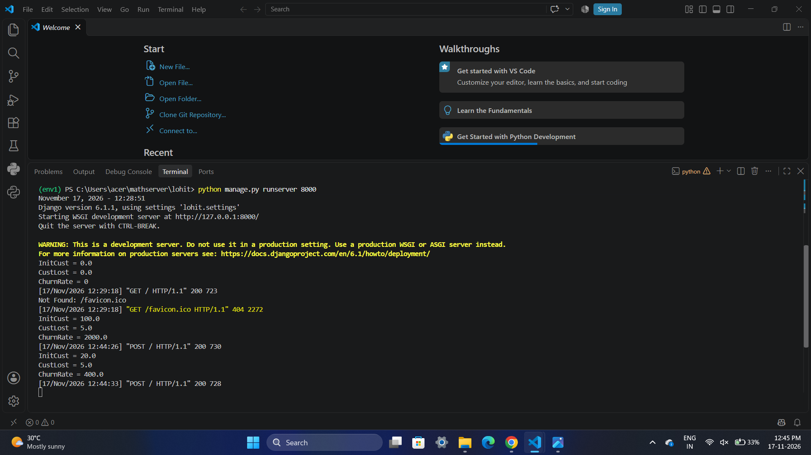
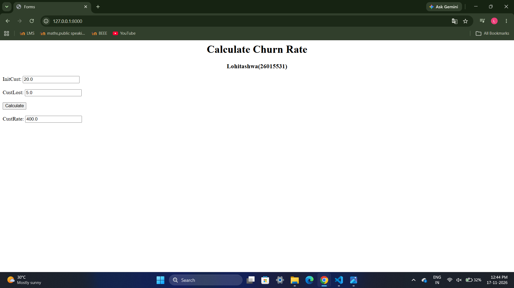

# Ex.03 Design a Website for Server Side Processing
## Date:17/11/26

## AIM:
To create a web page to calculate Churn Rate using server-side scripts.

## FORMULA:
Churn Rate = (CustLost / InitCust) * 100
<br> InitCust --> Initial Customers Count
<br> CustLost --> Customers Lost Count

## DESIGN STEPS:

### Step 1:
Clone the repository from GitHub.

### Step 2:
Create Django Admin project.

### Step 3:
Create a New App under the Django Admin project.

### Step 4:
Create a HTML file to implement form based input and output.

### Step 5:
Create python programs for views and urls to perform server side processing.

### Step 6:
Receive input values from the form using request.POST.get().

### Step 7:
Calculate the Result using the given formula.

### Step 8:
Display the calculated result in the server console.

### Step 9:
Render the result to the HTML template.

### Step 10:
Publish the website in Localhost.

## PROGRAM:
```
math.html

<htlm>
    <head>
        <title>Forms</title>
    </head>
    <body>
        <h1 align="center">Calculate Churn Rate</h1>
        <h3 align="center">Lohitashwa(26015531)</h3>
        <form method="post">
            
            <label>InitCust:</label>
            <input type="text" name="InitCust" value="{{v}}"><br><br>
            <label>CustLost:</label>
            <input type="text" name="CustLost" value="{{s}}"><br><br>
            <input type="submit" value="Calculate"><br><br>
            <label>CustRate:</label>
            <input type="text" value="{{ChurnRate}}">
        </form>
    </body>
</htlm>

urls.py

from django.contrib import admin
from django.urls import path
from myapp import views

urlpatterns = [path('', views.churn_cal, name='churn_cal'),]

views.py

from django.shortcuts import render
def churn_cal(request):
    v = float(request.POST.get('InitCust', '0'))
    s = float(request.POST.get('CustLost', '0'))
    ChurnRate = (v/s)*100 if request.method == 'POST' else 0
    print("InitCust =",v)
    print("CustLost =",s)
    print("ChurnRate =",ChurnRate)
    return render(request, 'myapp/math.html',{'v': v, 's': s, 'ChurnRate': ChurnRate})

```
## OUTPUT - SERVER SIDE:


## OUTPUT - WEBPAGE:


## RESULT:
The the web page to calculate Churn Rate using server-side scripts is created successfully.
